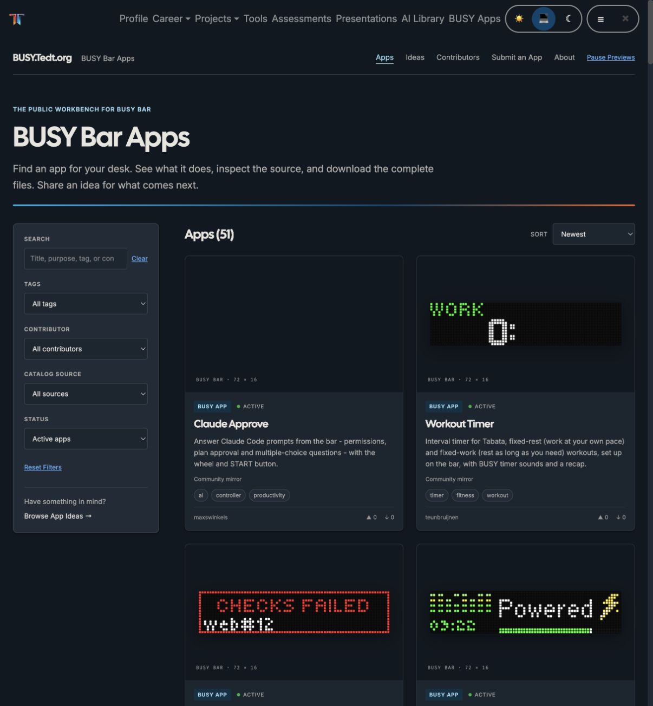
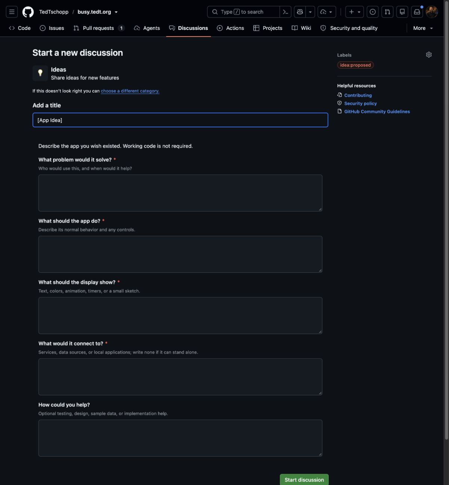

# Launch Verification — October 26, 2026

## Published site

- Website: https://busy.tedt.org/
- Repository: https://github.com/TedTschopp/busy.tedt.org
- Verified application release: `5f5e527a916c6b67b8ad3b1a252c976d9b2fd391`.
- Successful hosted release: [Refresh and Publish](https://github.com/TedTschopp/busy.tedt.org/actions/runs/40434139963).
- Successful manual production import: [workflow_dispatch run](https://github.com/TedTschopp/busy.tedt.org/actions/runs/40434608546).
- GitHub Pages custom domain and HTTPS enforcement are configured. The public version endpoint was checked through normal certificate validation.

## Verified behavior

- Eleven focused tests passed, covering complete imports, updates, idempotence, archiving, local-source preservation, unsafe-content rejection, deterministic ZIPs, idea lifecycle/status handling, discussion identity, and atomic download-event counting.
- Three browser tests passed locally and in hosted CI, covering catalog controls, themes, mobile layouts, reduced motion, review acknowledgment, and working downloads during a counter outage.
- Live HTTPS verification covered all **51 app pages**, **51 complete ZIPs**, **302 ZIP member hashes**, **51 app social previews**, the catalog JSON, and the main public routes.
- Individual source payloads are served as `application/octet-stream`.
- A real browser download of `clock.zip` matched its published SHA-256. Its event was recorded once as `community/clock: 1` by the production API.
- The giscus public categories API confirmed access to this repository, App Discussions, and Ideas. The embedded panels are enabled.
- GitHub rendered the structured Ideas form with its four required proposal fields and the `idea:proposed` label. No fabricated idea was submitted.
- Site dependency audit: zero reported npm vulnerabilities after the CSS parser override. This does not audit the dependencies of mirrored apps; see [SECURITY.md](../SECURITY.md).

Machine-readable evidence: [results.json](verification/results.json).

## Automation qualification

The daily GitHub import is configured for 3 a.m. America/Los_Angeles and the manual production path succeeded. The first actual scheduled occurrence is still pending for October 27, 2026; a manual run is not evidence that the scheduled trigger fired.

Ted explicitly approved a **single read-only check at 3:30 a.m. Pacific on October 27**. The Codex follow-up is created with a one-occurrence rule and may report the scheduled result; it may not edit the repository or change the GitHub schedule.

## Remaining account setup

The production download API and database are already deployed and healthy. The GitHub workflow for future counter-code deployments is prepared, but requires the user to save a scoped `CLOUDFLARE_API_TOKEN` repository secret. The existing Cloudflare connection can deploy resources but cannot mint that token. Automated Worker deployment will remain explicitly unqualified until the credential is saved and its workflow succeeds.

Normal daily catalog updates use the deployed API and do not depend on that deployment credential. See [operations](operations.md) for setup, moderation, refresh, and rollback procedures.
